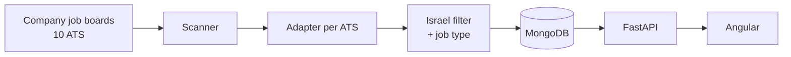

# Job Radar

[](https://github.com/Moshik520/job-radar/actions/workflows/ci.yml)

I built Job Radar while looking for a job in Israel. A lot of openings show up on a company's own careers
page days before they reach LinkedIn, or never reach it at all, so this pulls them directly from the
hiring systems companies use.

It scans the public job boards of about 12,350 companies on 10 applicant tracking systems (Greenhouse, Ashby,
Lever, Workable, Recruitee, Personio, Rippling, Workday, Comeet and SmartRecruiters), keeps the jobs located in Israel, sorts
them into job types and shows them in a web app with search and filters.

Built with Angular, Python (FastAPI), MongoDB and pytest.

## Features

- Search job titles and filter by one or more job types (QA, Full Stack, Data, Security, Sales and 26 more)
- Click a job to read the full description, pulled from the company's site
- Newest jobs first, with the posting date on every card
- Jobs removed from a company's site disappear on the next scan
- Star jobs to keep them in Favorites, and choose whether starred jobs also show up in the main list
- Remove a job with ✕ so later scans never bring it back
- Save jobs and track them: saved, applied, interview, offer, rejected

## How it works



Every ATS returns jobs in a different format (JSON, XML, and for Comeet, data embedded in an HTML page), so each
one has a small adapter in `backend/app/providers/` that converts it to the same `Job` model. Adding a tenth
provider means adding one file and one line in `providers/__init__.py`.

The scanner runs 30 requests at a time with `asyncio`. Some hosts (Workable, Workday, Recruitee, Comeet) start
returning 429 if you go too fast, so requests to them are rate limited and retried with backoff. A board that
fails is recorded on the company and skipped; it never stops the rest of the scan.

### Problems I ran into

- **Finding Israel in a location string.** Locations are free text: "Tel Aviv-Yafo", "Kiryat Gat, ISR",
  "Ra’anana" with a curly apostrophe, or Hebrew. Matching the word "Israel" also matched about 2,000 jobs at
  "Beth Israel Deaconess Medical Center" in Boston, and "IL" usually means Illinois. The city list in
  `locations.py` came from going through ~775,000 real job locations.
- **Sorting by date.** Every ATS writes dates differently (`2026-09-10T11:35:28-04:00`, `2026-10-11 07:09:39 UTC`,
  `2026-08-24`). Sorted as strings, a job posted in New York ended up in the wrong place, so all dates are
  converted to UTC when a job is saved.
- **Job types from titles.** Titles are the only thing every ATS has. `classify.py` checks ordered rules, so
  "Android Developer - AI Finance Agent" counts as mobile and not AI. It also handles Hebrew titles, which most
  Comeet jobs use.
- **Workday's 2,000 job limit.** Workday won't page past 2,000 results, so for NVIDIA most Israeli jobs were
  never reached (154 found out of 420). The scanner now reads each board's location filters and asks for Israel
  only. As a bonus, the ~1,250 Workday companies with no jobs in Israel now take one request each.
- **The company list goes stale.** Companies switch hiring systems: monday.com moved from Comeet to Ashby and the
  old board just returns an empty list. I went through ~250 Israeli tech companies, checked where each one
  actually posts jobs, and added 52 boards that were missing.
- **Closed jobs.** The scanner deletes a company's jobs that are no longer on its board, except when the scan
  didn't see the whole board (Workday stops at 2,000 jobs), so a partial scan can't delete open jobs.

## Running it

You need Python 3.13, Node 22+ and Docker.

```bash
docker compose up -d                # MongoDB

cd backend
python -m venv .venv
.venv\Scripts\activate              # macOS/Linux: source .venv/bin/activate
pip install -r requirements-dev.txt
python -m app.seed_companies        # load the company list
python -m app.scanner               # scan all boards, takes a while because of Workday
python -m app.fetch_details         # optional, downloads every job description in advance
fastapi dev app/main.py             # API on http://localhost:8000, docs at /docs

cd frontend
npm install
npx ng serve                        # http://localhost:4200
```

If you change the job type rules, run `python -m app.reclassify` to update the jobs already in the database.

## API

| | | |
|---|---|---|
| GET | `/jobs?search=&category=qa&category=backend&page=1` | jobs, newest first, 20 per page |
| GET | `/jobs/categories?search=` | number of jobs in each job type |
| GET | `/jobs/{id}` | one job |
| GET | `/jobs/{id}/details` | full description (fetched once, then cached) |
| POST | `/scan/greenhouse/{board}` | scan a single Greenhouse company |

## Tests

GitHub Actions runs everything on every push.

```bash
cd backend && pytest                          # needs MongoDB running for the API tests
cd frontend && npx ng test --watch=false
cd e2e && pytest                             # browser tests, see e2e/README.md
```

Backend (pytest, 136 tests):
- `test_api.py` calls every endpoint with FastAPI's `TestClient` against a separate test database: paging,
  search with characters like `C++`, filtering by several job types, 404 and 422 responses, and a scan that should
  keep only Israeli jobs and delete closed ones (the ATS is mocked).
- The other files are parametrized tests built from real data, including the bugs above (Beth Israel, time zones).

Frontend (Vitest, 60 tests): components rendered with `HttpTestingController` in place of the API. Covers loading,
empty and error states, retry, paging, opening and closing job cards, the job type dropdown, saving jobs, and
checks that scripts in a job description get stripped.

Browser tests (in `e2e/`): a few Selenium tests with page objects for the main flows (job list order, search,
filtering by two job types, opening cards and "Collapse all"), and Playwright tests that mock the API to check
the error screen, the retry button and a job that was closed on the company's site. They run against their own
API and database with fixed test data. See [e2e/README.md](e2e/README.md).

Two bugs were found by these tests: the status dropdown in My Applications always showed "saved" after a reload,
and the results counter said "1–20" on pages with fewer jobs.

## Project structure

```
backend/app/
  main.py          API
  scanner.py       scans all companies
  providers/       one adapter per ATS
  locations.py     Israel detection
  classify.py      job title -> job type
  details.py       job descriptions, cached in MongoDB
backend/data/companies.csv   company list
frontend/src/app/
  pages/           jobs, job page, favorites, my applications
  components/      job card, job type filter
  services/        API calls, saved jobs
```

## Next

- [ ] More browser tests (job page, saving jobs, My Applications)
- [ ] Run the backend and frontend in Docker too, and scan on a schedule
- [ ] Deploy it
- [ ] Rank jobs against an uploaded CV
