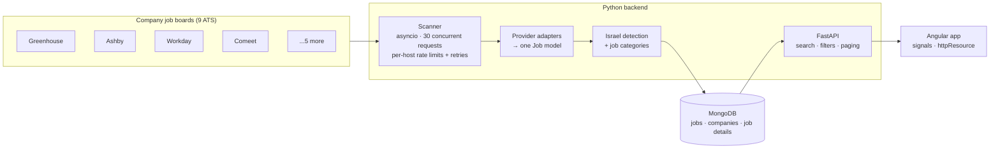

# Job Radar

[](https://github.com/Moshik520/job-radar/actions/workflows/ci.yml)

Job Radar finds open jobs in Israel straight from companies' own hiring systems, before or instead of LinkedIn.
It scans the public job boards of ~12,300 companies across 9 applicant-tracking systems (ATS), keeps only the
jobs located in Israel, sorts each one into a job type, and serves them through a searchable Angular app.

**Stack:** Angular · Python · FastAPI · MongoDB · pytest · Docker

## What it does

- **Aggregates 9 ATS providers** — Greenhouse, Ashby, Lever, Workable, Recruitee, Personio, Rippling, Workday and
  Comeet — each through its own adapter that maps a different JSON (or XML, or embedded-HTML) format to one `Job` model.
- **Israel only** — detects Israeli locations from free-text location fields ("Tel Aviv-Yafo", "Kiryat Gat, ISR",
  "Ra’anana", Hebrew text) while rejecting look-alikes ("Beth Israel Deaconess Medical Center, Boston", "Chicago, IL",
  "Nazareth, PA"). The rules were built from ~775,000 real job locations.
- **Job categories** — classifies every title (English and Hebrew) into one of 31 job types such as QA & Testing,
  Full Stack, Data, Security or Sales; the UI filters by several categories at once and shows a count for each.
- **Full job details** — fetches each job's description from its company's site, caches it in MongoDB, and shows it
  in an expandable job card.
- **Always current** — dates from every provider are normalized to UTC so jobs sort newest first, and jobs that
  disappear from a company's board are deleted on the next scan.
- **Track applications** — save jobs and move them through Saved → Applied → Interview → Offer / Rejected.

## Architecture



### Design decisions

| Decision | Why |
|---|---|
| One adapter per ATS behind a `FETCHERS` map | Adding a provider is one file and one line; the scanner never changes. |
| Fault isolation per company | Out of 12,300 boards some are always broken; one failure is recorded on the company and never stops the scan. |
| Per-host throttling with exponential backoff | Workable, Recruitee, Workday and Comeet answer `429 Too Many Requests` when pushed. |
| Classification at scan time, stored on the job | Filtering and per-category counts become plain indexed MongoDB queries. |
| Upsert by job id, delete what disappeared | Scans are idempotent; a closed posting leaves the site on the next scan. Partial scans (Workday's 2,000-job cap) never delete. |
| Job details fetched once, then cached | Opening a card is instant; a job edited on the ATS is fetched again. |
| Server-side search, filters and pagination | The browser never downloads the whole database. |

## API

Interactive docs at `http://localhost:8000/docs` (Swagger UI).

| Method | Endpoint | Description |
|---|---|---|
| GET | `/jobs?search=&category=qa&category=backend&page=1&page_size=20` | Jobs, newest first, with total count |
| GET | `/jobs/categories?search=` | Number of jobs per category for the current search |
| GET | `/jobs/{id}` | One job |
| GET | `/jobs/{id}/details` | The job's full description from the company's site (cached) |
| POST | `/scan/greenhouse/{board}` | Scan one Greenhouse company now |
| GET | `/health` | Health check |

## Running locally

Requirements: Python 3.13, Node 22+, Docker.

```bash
# 1. Database
docker compose up -d

# 2. Backend
cd backend
python -m venv .venv
.venv\Scripts\activate          # macOS/Linux: source .venv/bin/activate
pip install -r requirements-dev.txt
python -m app.seed_companies    # load the 12,300 companies
python -m app.scanner           # scan every board (Workday takes a while)
python -m app.fetch_details     # optional: prefetch every job's description
fastapi dev app/main.py         # http://localhost:8000

# 3. Frontend
cd frontend
npm install
npx ng serve                    # http://localhost:4200
```

After changing the classification rules, recompute every stored job with `python -m app.reclassify`.

## Tests

Every push runs both suites on GitHub Actions (backend against a real MongoDB service container).

```bash
# Backend: unit + API tests (API tests need MongoDB: docker compose up -d)
cd backend
pytest

# Frontend: component and service tests (Vitest + jsdom)
cd frontend
npx ng test --watch=false
```

**Backend — pytest (136 tests).** Data-driven (`pytest.mark.parametrize`) and built from real titles and locations
found while scanning, including regression cases for bugs found on real data: the Boston hospital chain that matched
"Israel", and New York time zones that broke the newest-first order.

| Suite | Covers |
|---|---|
| `test_api.py` | Every endpoint over HTTP with FastAPI `TestClient` against a test database: sorting, paging, search (incl. `C++` and other regex characters), single and multiple category filters, category counts, ids containing `/`, cached details, 404 / 422 responses, and a scan that stores only Israeli jobs and deletes closed ones (ATS mocked) |
| `test_locations.py` | Israeli city spellings, curly apostrophes, Hebrew, look-alike places that must not match |
| `test_classify.py` | Job titles in English and Hebrew → category |
| `test_providers.py` | Each adapter's transformations: Lever timestamps, Workday "Posted 3 Days Ago", Comeet country codes, Personio XML |
| `test_dates.py` | Every provider's date format → UTC, and correct sort order across time zones |
| `test_greenhouse.py`, `test_details.py` | Adapter mapping, missing fields, job id parsing |

**Frontend — Vitest (60 tests).** Components are rendered with the real template and an `HttpTestingController`
standing in for the API: loading, empty, error and retry states; paging; opening and closing job cards and
"Collapse all"; the multi-select category dropdown; saving jobs and changing their status; and that scripts in a
job description are stripped before it is shown.

## Project structure

```
job-radar/
├── docker-compose.yml          MongoDB
├── backend/
│   ├── app/
│   │   ├── main.py             FastAPI endpoints
│   │   ├── scanner.py          concurrent scan of every company
│   │   ├── providers/          one adapter per ATS + shared HTTP helpers
│   │   ├── locations.py        Israel detection
│   │   ├── classify.py         job title → category
│   │   ├── details.py          job descriptions with MongoDB cache
│   │   └── models.py           Pydantic models
│   ├── data/companies.csv      ~12,300 companies and their ATS board ids
│   └── tests/
└── frontend/src/app/
    ├── pages/                  jobs list, job details, my applications
    ├── components/             job card, category filter
    └── services/               API access and application tracking
```

## Roadmap

- [ ] UI end-to-end tests: Selenium (Page Object Model) and Playwright (network mocking)
- [x] API tests with FastAPI `TestClient`
- [x] GitHub Actions CI running every suite on each push
- [ ] Backend and frontend in Docker Compose; scheduled scans
- [ ] Public deployment
- [ ] AI agent that ranks jobs against an uploaded CV
